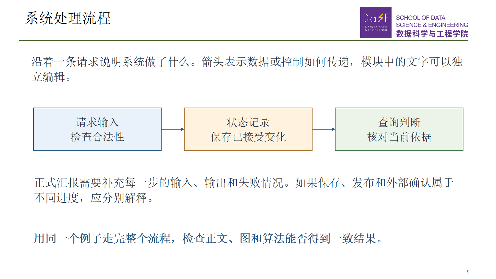

# 华师大区块链实验室汇报模板参考

用于研究生组会、论文阅读和阶段进展汇报的PPT模板与制作流程。保留华东师范大学数据科学与工程学院参考PPT的视觉风格，将研究问题、设计思路和实验证据组织成可以连续讲解的中文汇报。

本仓库整理自 [HotRevoke 项目](https://github.com/Minjie2003/hotrevoke) 中获得认可的11.13周报。既提供可以直接修改的PowerPoint文件，也提供可安装的Codex skill和独立Python构建脚本。

## 先打开这些文件

| 用途 | 文件 |
| --- | --- |
| 直接填写的新汇报起点 | [可编辑PPTX](templates/ecnu-report-starter.pptx) · [PDF预览](templates/ecnu-report-starter.pdf) |
| 获认可的实际研究案例 | [HotRevoke周报PPTX](examples/hotrevoke-week9/approved-report.pptx) · [PDF](examples/hotrevoke-week9/approved-report.pdf) · [逐页讲稿](examples/hotrevoke-week9/SPEAKER_NOTES.md) |
| 原始学校进展汇报模板 | [参考PPTX](templates/reference/ecnu-progress-original.pptx) |
| 可复用的AI制作流程 | [SKILL.md](skills/ecnu-blockchain-report/SKILL.md) |
| 修改内容的JSON示例 | [starter.json](examples/starter.json) |

模板保留封面、主要任务、研究进展、本周学习体会与反思、下周科研计划和感谢页。示例页数只提供起点，可按每周新增内容增删。正文使用连贯说明、原生表格、流程图和图表，进一步解释放在幻灯片备注中。



[封面预览](docs/previews/starter-01.png) · [可编辑图表页预览](docs/previews/starter-07.png)

## 使用方法

### 在PowerPoint或WPS里直接修改

下载仓库后，复制 `templates/ecnu-report-starter.pptx`，修改题目、汇报人、日期和正文。图形、表格与数值图表可编辑，流程连线绑定到模块。需要新数据时编辑图表工作簿，并核对图注和结论。

`starter`中的数值是明确标注的示例数据，不是实验结果。HotRevoke案例中的数值属于原项目的特定实验，使用时保留其来源、条件、单位和局限。

### 作为Codex skill使用

在仓库根目录执行：

```powershell
python scripts/install_skill.py
```

安装器将skill及所需脚本、模板、示例一并复制到个人技能目录，默认是 `~/.codex/skills/ecnu-blockchain-report`，也支持已有 `CODEX_HOME` 设置。若同名技能已经存在，安装器会停止，避免覆盖你的修改；可以使用 `--name ecnu-blockchain-report-2`另存。

随后在能发现该个人技能的Codex会话中使用：

```text
使用 $ecnu-blockchain-report，根据我本周的论文与实验资料制作组会汇报。
保留学校模板，重点说明本周新增内容，提供逐页讲稿和对应PDF。
```

也可以直接让Codex读取仓库内的 `skills/ecnu-blockchain-report/SKILL.md`，无需安装。该技能是独立整理的实际工作流程；上次使用的Presentations技能版本、参考文件和SHA256见[来源记录](docs/ORIGINS.md)。

### 通过内容文件构建

需要Python 3.10或更高版本。在仓库根目录运行：

```powershell
python -m pip install -r requirements.txt
python scripts/build_report.py --content examples/starter.json --output outputs/my-report.pptx
python scripts/validate_report.py outputs/my-report.pptx
```

先复制 `examples/starter.json`，再填写本周内容。构建器支持的布局及字段以该文件和 `python scripts/build_report.py --help` 为准。它读取本仓库冻结参考PPT，生成原生对象和备注，不需要HotRevoke论文目录、插件缓存、账号或API密钥。

Windows上安装了PowerPoint或兼容COM的WPS时，可导出所有页面和PDF：

```powershell
python scripts/render_report.py --input outputs/my-report.pptx --output-dir outputs/preview --pdf
```

PDF默认保存在PPT旁边，预览和实际导出记录在指定目录。构建与结构检查可独立运行；自动渲染脚本需要Windows、`pywin32`和已安装的演示文稿应用。其他平台可在本地办公软件中打开PPTX并手动导出。

## 这套流程保留什么

首先明确本周新增内容，再用一个连续例子连接问题、已有方法、架构、算法和实验。术语第一次出现时说明含义，主要任务、反思与下周计划相互对应。

制作时沿用实际模板的画幅、标志、字体角色和分隔线。表格、数据图和主要流程图保持可编辑；箭头方向与条件先按研究含义核对，再调整位置。收益与额外成本一起呈现，保留无收益、失败和未测范围。

最后保存PPTX，渲染每一页并实际查看，修正溢出、遮挡、裁切与绕线问题。结构检查通过不能代替视觉检查。必要时安排独立的内容审查和数据审查，在临时副本中验证文字编辑、连线跟随及保存重开。

具体说明见[制作流程](skills/ecnu-blockchain-report/references/workflow.md)和[文字与视觉约定](skills/ecnu-blockchain-report/references/style-guide.md)。

## 目录

```text
skills/ecnu-blockchain-report/   专用SKILL.md及说明
templates/                      通用起点和冻结参考PPT
examples/                       内容JSON和真实汇报案例
scripts/                        构建、检查、导出和安装脚本
docs/                           来源、使用示例和预览
validation/                     本次模板实际验证记录
```

临时报告、渲染缓存和本地环境放在 `outputs/` 或 `.validation/`，这些目录不会进入Git。生成的新周报以你指定的文件为交付入口，不需要重复创建“最终版”文件夹。

## 来源与许可

脚本和本仓库重新编写的说明采用[MIT许可证](LICENSE)。学校标志、原始参考PPT及其中的第三方素材保留各自权利，不因脚本许可而重新授权，见[素材说明](NOTICE.md)和[来源清单](docs/source_manifest.json)。本仓库由个人整理，用于汇报模板参考，不代表学校或实验室官方发布。
